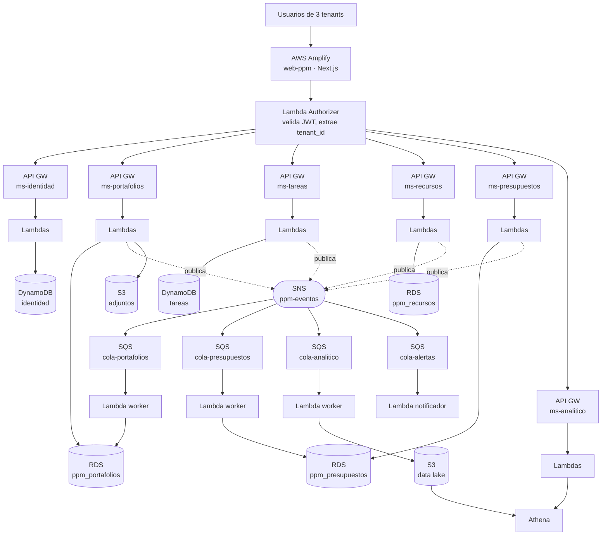

# Arquitectura de Solución — PPM SaaS (CS2032 · Grupo 4)

**Producto:** `Portafolio` — SaaS de *Project Portfolio Management*. Gestiona
portafolios, proyectos, tareas, recursos, presupuestos y prioridades para
organizaciones distintas (tenants) sobre una misma infraestructura.

**Referentes del rubro:** monday.com, Smartsheet, Planview.

---

## 1. Los tres pilares que exige el enunciado

### 1.1 Multi-tenancy
Un solo despliegue atiende a varias organizaciones con datos aislados.

- El `tenant_id` viaja **dentro del JWT**, nunca en el body ni en la URL. Así el
  cliente no puede pedir datos de otro tenant cambiando un parámetro.
- Un **Lambda Authorizer** compartido valida el token en cada API Gateway y
  pasa el `tenant_id` a la Lambda en el `requestContext.authorizer`.
- Aislamiento en la capa de datos:
  - **DynamoDB:** el `tenant_id` es el prefijo de la *partition key*
    (`TENANT#t-acme`), de modo que una query jamás puede cruzar tenants.
  - **RDS (PostgreSQL):** patrón **Single Database, Multiple Schemas** —
    un schema por tenant, y la Lambda hace `SET search_path TO <schema>`
    según el `tenant_id` del token.

**Tenants de la demo (3 en datos, 2 en la demo en vivo):**

| tenant_id | Organización | Rubro |
|---|---|---|
| `t-acme` | Acme Ingeniería | Construcción |
| `t-globex` | Globex Consulting | Consultoría TI |
| `t-initech` | Initech Software | Desarrollo de software |

### 1.2 Serverless
Nada de servidores que administrar: **API Gateway + Lambda + DynamoDB + S3**.
El único componente no-serverless es el RDS, y está ahí porque el enunciado lo
pide explícitamente para los microservicios relacionales. Todo el despliegue
se automatiza con **Serverless Framework** (`serverless.yml` por repo).

### 1.3 Basada en eventos (EDA)
Los microservicios **no se llaman entre sí por HTTP**. Cuando algo pasa, el
microservicio dueño del dato publica un evento en **SNS**; quien le interese se
suscribe con una **cola SQS** propia y lo procesa en su propia Lambda.

Esto es lo que nos da el desacoplamiento: si `ms-tareas` está caído,
`ms-portafolios` sigue atendiendo y los eventos se acumulan en la cola.

---

## 2. Microservicios (6, el mínimo es 5)

| # | Microservicio | Base de datos | Responsabilidad |
|---|---|---|---|
| 1 | `ms-identidad` | DynamoDB | Tenants, usuarios, login, emisión de JWT |
| 2 | `ms-portafolios` | RDS · `ppm_portafolios` | Portafolios, proyectos, prioridades, estados |
| 3 | `ms-tareas` | DynamoDB | Tareas, hitos, dependencias, % de avance |
| 4 | `ms-recursos` | RDS · `ppm_recursos` | Personas, roles, capacidad, asignaciones |
| 5 | `ms-presupuestos` | RDS · `ppm_presupuestos` | Presupuesto por proyecto, gastos, ejecución |
| 6 | `ms-analitico` | S3 + Athena | Data lake de eventos, KPIs del portafolio |

**Cómo convive "un único RDS" con "cada microservicio su propia BD":**
una sola instancia RDS PostgreSQL, **una database por microservicio**, y dentro
de cada database **un schema por tenant**:

```
RDS ppm-rds (una sola instancia)
├── database ppm_portafolios
│   ├── schema t_acme
│   ├── schema t_globex
│   └── schema t_initech
├── database ppm_recursos      → mismos 3 schemas
└── database ppm_presupuestos  → mismos 3 schemas
```

Cada microservicio solo conoce su propia database y su propio usuario de BD.

---

## 3. Diagrama de arquitectura



---

## 4. Uso de S3, SNS y SQS (lo que pide el enunciado)

| Servicio | Para qué lo usamos |
|---|---|
| **S3** | (a) *Data lake* de eventos en JSON particionado por `tenant_id/fecha`, que es la fuente de Athena; (b) bucket de adjuntos de proyectos (actas, cotizaciones) con key prefijada por tenant; (c) exportes de reportes en CSV. |
| **SNS** | Un topic `ppm-eventos` con atributos de mensaje (`tipo`, `tenant_id`) para que cada suscriptor filtre solo lo suyo. Además un topic `ppm-alertas` para notificar sobreejecución de presupuesto. |
| **SQS** | Una cola por consumidor, suscrita al SNS con *filter policy*. Cada cola tiene su **DLQ** con `maxReceiveCount: 3`. Esto es lo que hace el sistema tolerante a fallos. |

## 5. Volumen de datos

30,000 registros por microservicio, repartidos en 3 tenants (~10,000 por
tenant). El reparto por tabla/entidad lo define cada responsable, pero debe
documentarse. Se generan con un script `seed/` en cada repo (Faker) y se
ejecuta como Lambda o en lote local.

> Ojo: 30,000 son **registros del microservicio**, no de una sola tabla. Ej. en
> `ms-portafolios`: 300 portafolios + 4,700 proyectos + 25,000 filas de
> historial de estado = 30,000.

## 6. Decisiones de arquitectura ya tomadas

1. **APIs autónomas.** Ningún microservicio llama a otro por HTTP. Las
   referencias cruzadas (`proyecto_id`, `usuario_id`) son identificadores
   lógicos, sin FK ni validación remota. *Por qué:* que el atraso de un
   integrante no bloquee a los demás.
2. **Identidad es su propio microservicio.** El ACL ya nos lo exigió en el
   proyecto parcial. Solo `ms-identidad` emite JWT; los demás solo verifican
   la firma con el secreto compartido, sin llamada HTTP.
3. **Frontend en Next.js** desplegado en Amplify.
4. **Un solo repo de infraestructura compartida** (`infra-compartida`) que crea
   RDS, SNS, S3 y el Lambda Authorizer, y exporta sus ARNs por CloudFormation
   Outputs. Los demás repos los importan. *Por qué:* evita que seis
   `serverless.yml` se pisen creando el mismo bucket.
5. **Región única:** `us-east-1`.
